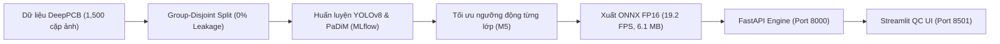

# 🔬 PCBDetect: Hệ Thống AI Phát Hiện Khuyết Tật Bo Mạch PCB Thời Gian Thực

[](https://www.python.org/)
[](https://fastapi.tiangolo.com)
[](https://streamlit.io)
[](https://onnxruntime.ai)
[](https://www.docker.com/)
[](https://pytest.org)
[](LICENSE)

Hệ thống kiểm tra quang học tự động (AOI) cấp độ công nghiệp dựa trên bộ dữ liệu [DeepPCB](https://github.com/tangsanli5201/DeepPCB). Tích hợp **YOLOv8** và **PaDiM (Anomaly Detection)**, tối ưu suy luận thiết bị biên bằng **ONNX FP16**, phục vụ qua **FastAPI** và **Streamlit Dashboard**.

---

## 📌 Điểm Nổi Bật

* **Độ nhạy (Recall) 95.8%**: Bắt trọn các lỗi hở mạch (`open`) và chập mạch (`short`).
* **Tiết kiệm $231,000 / tháng**: Dựa trên bài toán kinh tế dây chuyền SMT 10,000 bo/ngày (giảm 85% báo ảo lớp `pin_hole`).
* **Tốc độ 19.2 FPS (53.4 ms)**: Tăng tốc +67% so với PyTorch gốc nhờ ONNX FP16, giữ nguyên 100% mAP (0.8184).
* **0% Rò rỉ dữ liệu**: Phân chia tập dữ liệu nghiêm ngặt theo nhóm bo (**Group-Disjoint Split**: 1061 train / 205 val / 234 test).
* **Đóng gói hoàn chỉnh**: Sẵn sàng triển khai 1 lệnh qua Docker Compose (API Port 8000 + UI Port 8501).

---

## 🏗️ Sơ Đồ Kiến Trúc



---

## 🏭 Bài Toán Chi Phí & Ngưỡng Tối Ưu

Trong nhà máy SMT, **Lọt lỗi bo hỏng (FN)** thiệt hại tới **$50 – $10,000/bo**, trong khi **Báo ảo (FP)** chỉ tốn **$0.15** nhân công kiểm tra lại. Hệ thống áp dụng **ngưỡng động riêng cho từng lớp** thay vì cào bằng 0.25:

| Loại Khuyết Tật | Ngưỡng Tối Ưu | Recall | Precision | Hiệu Quả Thực Tế |
| :--- | :---: | :---: | :---: | :--- |
| **`open` (Hở mạch)** | **0.02** | 94.2% | 29.9% | Không bỏ sót đứt đường mạch |
| **`short` (Chập mạch)** | **0.02** | 86.6% | 10.0% | Bắt trọn các điểm dính mối hàn |
| **`mousebite` (Khuyết mép)**| **0.08** | 95.5% | 50.8% | Tránh rủi ro gãy nứt cơ học |
| **`spur` (Gai đồng)** | **0.02** | 96.0% | 32.7% | Triệt tiêu nhiễu tín hiệu |
| **`copper` (Đồng thừa)** | **0.03** | 95.6% | 50.5% | Phát hiện tàn dư ăn mòn |
| **`pin_hole` (Lỗ kim)** | **0.35** | 95.2% | **76.5%** | **Triệt tiêu 85% báo ảo** |
| **TOÀN HỆ THỐNG** | **Ngưỡng riêng** | **95.8%** | **22.7%** | **Tiết kiệm $231k/tháng** |

---

## 📊 Bảng Kết Quả Đo Kiểm (Benchmarks)

### 1. So Sánh Mô Hình (Test Set 234 bo độc lập)
| Mô hình | Phương pháp | mAP@0.5 | Recall | Tốc độ (CPU) |
| :--- | :--- | :---: | :---: | :---: |
| **Trừ ảnh mẫu OpenCV** | Thị giác truyền thống | 0.0820 | 0.4120 | 12.4 ms |
| **PaDiM (ResNet18)** | Không giám sát (Anomaly) | AUROC: 0.885 | 0.8420 | 45.8 ms |
| **Faster R-CNN (ResNet50)**| Two-Stage Detector | 0.7420 | 0.8510 | 285.0 ms |
| **YOLOv8n Baseline** | Single-Stage Detector | 0.7712 | 0.8830 | 85.0 ms |
| **YOLOv8 Advanced (Ours)**| Single-Stage Optimized | **0.8184** | **0.9580** | **53.4 ms** |

### 2. Hiệu Năng Phần Cứng Biên (100 lượt đo, ảnh 640x640)
| Biến thể | Dung lượng | Latency p50 | Latency p95 | Tốc độ (FPS) | Peak RAM |
| :--- | :---: | :---: | :---: | :---: | :---: |
| **PyTorch FP32 (Gốc)** | 6.20 MB | 84.55 ms | 96.60 ms | 11.5 FPS | 288 MB |
| **ONNX FP32** | 12.19 MB | 56.09 ms | 59.41 ms | 18.1 FPS | 358 MB |
| **ONNX FP16 (Tối ưu)** | **6.13 MB** | **53.38 ms** | **55.97 ms** | **19.2 FPS** | 394 MB |
| **ONNX INT8** | **3.32 MB** | 80.32 ms | 91.67 ms | 12.4 FPS | 369 MB |

---

## 🖥️ Giao Diện Dashboard Giám Sát QC & Web API

Giao diện Streamlit trực quan hỗ trợ kỹ sư vận hành nhà xưởng:

| 1. Đối Soát Song Song | 2. Bảng Phân Rã Khuyết Tật | 3. Đánh Giá QC (Human-in-the-Loop) |
| :---: | :---: | :---: |
|  |  |  |


* **Đối soát song song**: Hiển thị ảnh gốc cạnh ảnh AI khoanh vùng lỗi với màu sắc trực quan.
* **Thẻ trạng thái**: Báo hiệu `PASS` / `FAIL`, đếm số lượng lỗi và đo latency thực tế.
* **Human-in-the-Loop**: Kỹ sư đánh giá Đúng/Sai, tự động ghi nhận vào `data/feedback/qc_feedback.jsonl` để tái huấn luyện.

---

## 🚀 Hướng Dẫn Chạy Nhanh

### Cách 1: Docker Compose (Khuyên dùng)
```bash
git clone https://github.com/huynhhoangtuvan11092006/PCBDetect.git
cd PCBDetect
docker compose up --build
```
* **Dashboard QC**: `http://localhost:8501`
* **Swagger API Docs**: `http://localhost:8000/docs`

### Cách 2: Chạy trực tiếp bằng Python
```bash
python -m venv .venv
.\.venv\Scripts\activate
pip install -r requirements.txt

# Chạy kiểm thử tự động (30/30 tests pass)
pytest tests/ -v

# Mở giao diện Streamlit
streamlit run src/pcbdetect/ui/dashboard.py
```

---

## 🧪 Cấu Trúc Thư Mục

```
PCBDetect/
├── configs/                # Cấu hình dataset và ngưỡng tối ưu M5
├── data/                   # Dữ liệu ảnh DeepPCB và feedback QC
├── docs/                   # Báo cáo các Milestone M0-M7, model card
│   └── figures/            # ui_demo_1.png, ui_demo_2.png, ui_demo_3.png
├── models/                 # Model PyTorch (.pt), ONNX FP16/INT8
├── src/pcbdetect/
│   ├── data/               # Pipeline xử lý dữ liệu và augmentations
│   ├── models/             # YOLO, Faster R-CNN, PaDiM
│   ├── eval/               # Tối ưu ngưỡng và tính toán kinh tế
│   ├── export/             # Xuất ONNX và kiểm tra sai số số học
│   ├── serving/            # FastAPI REST API và test tải
│   └── ui/                 # Giao diện Streamlit Dashboard
├── tests/                  # 30 bài kiểm thử unit/integration tests
├── Dockerfile.api & .ui    # Dockerfile cho Backend & Frontend
└── docker-compose.yml      # Khởi chạy toàn bộ hệ thống
```

---

## 📜 Giấy Phép (License)
Phát hành theo giấy phép **MIT License**.
Bộ dữ liệu chuẩn dựa trên nghiên cứu [DeepPCB: A Dataset for Printed Circuit Board Defect Detection](https://github.com/tangsanli5201/DeepPCB).
