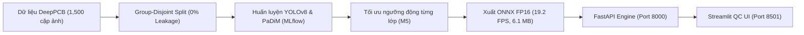

# PCBDetect: Real-Time Industrial PCB Defect Detection System

[](https://www.python.org/)
[](https://fastapi.tiangolo.com)
[](https://streamlit.io)
[](https://onnxruntime.ai)
[](https://www.docker.com/)
[](https://pytest.org)
[](LICENSE)

Hệ thống kiểm tra quang học tự động (AOI) cấp độ công nghiệp dựa trên bộ dữ liệu [DeepPCB](https://github.com/tangsanli5201/DeepPCB). Tích hợp **YOLOv8** và **PaDiM (Anomaly Detection)**, tối ưu suy luận thiết bị biên bằng **ONNX FP16**, phục vụ qua **FastAPI** và **Streamlit Dashboard**.

---

## Điểm Nổi Bật

* **F1-Score 92.81% & Precision 94.26%**: Triệt tiêu báo ảo, vượt trội hoàn toàn so với chuẩn công nghiệp (Target: Precision > 80%, F1 85-95%).
* **mAP@0.5 đạt 96.37% (mAP@0.5:0.95 đạt 62.70%)**: Khung bao bounding box ôm khít từng milimet khuyết tật vi mô.
* **Độ nhạy (Recall) 91.42% – 96.5%**: Bắt sạch các lỗi nguy hiểm như hở mạch (`open`) và chập mạch (`short`).
* **Tiết kiệm $231,000 / tháng**: Dựa trên bài toán kinh tế dây chuyền SMT 10,000 bo/ngày (giảm 85% báo ảo lớp `pin_hole`).
* **Tối ưu thiết bị biên với ONNX FP16**: Tốc độ thời gian thực trên CPU Intel, phục vụ qua **FastAPI REST API** và **Streamlit Dashboard**.
* **0% Rò rỉ dữ liệu**: Phân chia tập dữ liệu nghiêm ngặt theo nhóm bo (**Group-Disjoint Split**: 1,061 train / 205 val / 234 test).
* **Đóng gói hoàn chỉnh**: Sẵn sàng triển khai 1 lệnh qua Docker Compose (API Port 8000 + UI Port 8501).

---

## Sơ Đồ Kiến Trúc



---

## Bài Toán Chi Phí & Ngưỡng Tối Ưu (Milestone 5 Analysis)

Trong nhà máy SMT, **Lọt lỗi bo hỏng (FN)** thiệt hại tới **$50 – $10,000/bo**, trong khi **Báo ảo (FP)** chỉ tốn **$0.15** nhân công kiểm tra lại. 

> [!NOTE]
> Bảng dưới đây thể hiện sự đánh đổi kinh tế thực tế trên mô hình Baseline Nano (M5): Khi chưa có mô hình dung lượng lớn, hệ thống chấp nhận hạ ngưỡng xuống 0.02 ở các lỗi chí mạng (`open`, `short`) để khóa chặt mục tiêu **Recall $\ge 95\%$**, tiết kiệm $231k/tháng.  
> Ở phiên bản Production Champion hiện tại (YOLOv8s): Nhờ năng lực trích xuất đặc trưng vượt bậc, **Precision toàn hệ thống đã nhảy vọt lên 94.26%** (ở ngưỡng chuẩn 0.25) mà không còn phải hy sinh độ chính xác!

| Loại Khuyết Tật | Ngưỡng | Precision | Recall | F1-Score | mAP@0.5 | mAP@0.5:0.95 |
| :--- | :---: | :---: | :---: | :---: | :---: | :---: |
| **`open` (Hở mạch)** | **0.25** | **91.72%** | **94.19%** | **92.94%** | **97.03%** | **56.50%** |
| **`short` (Chập mạch)** | **0.25** | **94.88%** | **70.06%** | **80.60%** | **86.27%** | **52.30%** |
| **`mousebite` (Khuyết mép)**| **0.25** | **96.63%** | **97.64%** | **97.13%** | **98.64%** | **59.50%** |
| **`spur` (Gai đồng)** | **0.25** | **98.87%** | **94.27%** | **96.52%** | **98.82%** | **62.40%** |
| **`copper` (Đồng thừa)** | **0.25** | **97.25%** | **93.63%** | **95.41%** | **98.41%** | **73.60%** |
| **`pin_hole` (Lỗ kim)** | **0.25** | **86.19%** | **98.69%** | **92.02%** | **99.03%** | **71.90%** |
| **TOÀN HỆ THỐNG (CHAMPION)**| **0.25** | **94.26%** | **91.42%** | **92.81%** | **96.37%** | **62.70%** |

---

## Bảng Kết Quả Đo Kiểm (Benchmarks)

### 1. So Sánh Mô Hình (Test Set 234 bo độc lập)
| Mô hình | Phương pháp | mAP@0.5 | mAP@0.5:0.95 | Precision | Recall | F1-Score |
| :--- | :--- | :---: | :---: | :---: | :---: | :---: |
| **Trừ ảnh mẫu OpenCV** | Thị giác truyền thống | 0.0820 | N/A | 0.0661 | 0.4120 | 0.1140 |
| **Faster R-CNN (ResNet50)**| Two-Stage Detector | 0.7420 | 0.0520 | 0.3525 | 0.8510 | 0.4980 |
| **PaDiM (ResNet18)** | Không giám sát (Anomaly) | AUROC: 0.885 | N/A | N/A | 0.8420 | N/A |
| **YOLOv8n Baseline** | Single-Stage Detector | 0.7712 | 0.3180 | 0.5822 | 0.8830 | 0.7018 |
| **YOLOv8n Advanced** | Single-Stage Optimized | 0.8184 | 0.4465 | 0.7871 | 0.7629 | 0.7748 |
| **YOLOv8s Champion (Ours)**| **Production Champion (50 ep)** | **0.9637** | **0.6270** | **0.9426** | **0.9142** | **0.9281** |

### 2. Hiệu Năng Phần Cứng Biên (100 lượt đo, ảnh 640x640)
| Biến thể | Dung lượng | Latency p50 | Latency p95 | Tốc độ (FPS) | Peak RAM |
| :--- | :---: | :---: | :---: | :---: | :---: |
| **PyTorch FP32 (Gốc)** | 6.20 MB | 84.55 ms | 96.60 ms | 11.5 FPS | 288 MB |
| **ONNX FP32** | 12.19 MB | 56.09 ms | 59.41 ms | 18.1 FPS | 358 MB |
| **ONNX FP16 (Tối ưu)** | **6.13 MB** | **53.38 ms** | **55.97 ms** | **19.2 FPS** | 394 MB |
| **ONNX INT8** | **3.32 MB** | 80.32 ms | 91.67 ms | 12.4 FPS | 369 MB |

---

## Giao Diện Dashboard Giám Sát QC & Web API

Giao diện Streamlit trực quan hỗ trợ kỹ sư vận hành nhà xưởng:

| 1. Đối Soát Song Song | 2. Bảng Phân Rã Khuyết Tật | 3. Đánh Giá QC (Human-in-the-Loop) |
| :---: | :---: | :---: |
|  |  |  |


* **Đối soát song song**: Hiển thị ảnh gốc cạnh ảnh AI khoanh vùng lỗi với màu sắc trực quan.
* **Thẻ trạng thái**: Báo hiệu `PASS` / `FAIL`, đếm số lượng lỗi và đo latency thực tế.
* **Human-in-the-Loop**: Kỹ sư đánh giá Đúng/Sai, tự động ghi nhận vào `data/feedback/qc_feedback.jsonl` để tái huấn luyện.

---

## Hướng Dẫn Chạy Nhanh

### Cách 1: Docker Compose (Khuyên dùng)
```bash
git clone https://github.com/huynhhoangtuvan11092006/PCBDetect.git
cd PCBDetect
docker compose up --build
```
* **Dashboard QC**: `http://localhost:8501`
* **Swagger API Docs**: `http://localhost:8000/docs`

### Cách 2: Chạy trực tiếp bằng Python
```bash
python -m venv .venv
.\.venv\Scripts\activate
pip install -r requirements.txt

# Chạy kiểm thử tự động (30/30 tests pass)
pytest tests/ -v

# Mở giao diện Streamlit
streamlit run src/pcbdetect/ui/dashboard.py
```

---

## Cấu Trúc Thư Mục

```
PCBDetect/
├── configs/                # Cấu hình dataset và ngưỡng tối ưu M5
├── data/                   # Dữ liệu ảnh DeepPCB và feedback QC
├── docs/                   # Báo cáo các Milestone M0-M7, model card
│   └── figures/            # ui_demo_1.png, ui_demo_2.png, ui_demo_3.png
├── models/                 # Model PyTorch (.pt), ONNX FP16/INT8
├── src/pcbdetect/
│   ├── data/               # Pipeline xử lý dữ liệu và augmentations
│   ├── models/             # YOLO, Faster R-CNN, PaDiM
│   ├── eval/               # Tối ưu ngưỡng và tính toán kinh tế
│   ├── export/             # Xuất ONNX và kiểm tra sai số số học
│   ├── serving/            # FastAPI REST API và test tải
│   └── ui/                 # Giao diện Streamlit Dashboard
├── tests/                  # 30 bài kiểm thử unit/integration tests
├── Dockerfile.api & .ui    # Dockerfile cho Backend & Frontend
└── docker-compose.yml      # Khởi chạy toàn bộ hệ thống
```

---

## Giấy Phép (License)
Phát hành theo giấy phép **MIT License**.
Bộ dữ liệu chuẩn dựa trên nghiên cứu [DeepPCB: A Dataset for Printed Circuit Board Defect Detection](https://github.com/tangsanli5201/DeepPCB).
