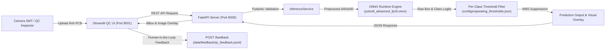

# Báo Cáo Milestone 7: Serving, Web API, Streamlit QC UI & Dockerization

## 1. Tổng Quan Kiến Trúc Serving (System Architecture)

Trong Milestone 7, **PCBDetect** đã được nâng cấp thành một hệ thống phục vụ suy luận hoàn chỉnh (End-to-End Production Serving Pipeline) sẵn sàng triển khai trong nhà máy SMT:



---

## 2. Các Thành Phần Đã Triển Khai

### 2.1. Backend API (`FastAPI` & `Pydantic`)
* **File mã nguồn**: [`src/pcbdetect/serving/app.py`](file:///c:/PCBDetect/src/pcbdetect/serving/app.py), [`src/pcbdetect/serving/schemas.py`](file:///c:/PCBDetect/src/pcbdetect/serving/schemas.py), [`src/pcbdetect/serving/inference_service.py`](file:///c:/PCBDetect/src/pcbdetect/serving/inference_service.py)
* **Lifespan Context Management**: Nạp mô hình `yolov8_advanced_fp16.onnx` vào RAM ngay khi khởi động server, loại bỏ phụ phí nạp model ở từng request.
* **Per-Class Threshold Filtering**: Tự động tích hợp bộ ngưỡng tối ưu từng lớp từ Milestone 5 (`open: 0.02`, `short: 0.02`, `mousebite: 0.08`, `spur: 0.02`, `copper: 0.03`, `pin_hole: 0.35`) để triệt tiêu báo ảo.
* **Endpoints**:
  * `GET /health`: Trả về trạng thái hoạt động (`healthy`), phiên bản model, RAM footprint và per-class thresholds.
  * `POST /predict`: Nhận file ảnh tải lên (`multipart/form-data`), trả về:
    * `status`: `"PASS"` (bo đạt) hoặc `"FAIL"` (bo lỗi).
    * `detections`: Danh sách bounding box, tên lớp khuyết tật, điểm tin cậy, và mức độ nghiêm trọng (`CRITICAL`, `MAJOR`, `MINOR`).
    * `latency`: Phân rã thời gian tiền xử lý, suy luận ONNX, hậu xử lý NMS.
    * `overlay_base64`: Chuỗi ảnh PNG mã hóa Base64 vẽ sẵn hộp lỗi để hiển thị tức thời.
  * `POST /feedback`: Tiếp nhận đánh giá Đúng/Sai từ kỹ sư QC và ghi nhận vào [`data/feedback/qc_feedback.jsonl`](file:///c:/PCBDetect/data/feedback/qc_feedback.jsonl) phục vụ vòng lặp Active Learning.

### 2.2. Giao Diện Người Dùng Giám Sát QC (`Streamlit Dashboard`)
* **File mã nguồn**: [`src/pcbdetect/ui/dashboard.py`](file:///c:/PCBDetect/src/pcbdetect/ui/dashboard.py)
* **Tính năng chuyên biệt cho nhà xưởng**:
  * **Chế độ xem Song song (Side-by-Side)**: Ảnh gốc cạnh ảnh phân tích AI với các hộp khoanh lỗi mang màu sắc đặc trưng từng loại khuyết tật.
  * **Thẻ trạng thái lớn**: Hiển thị rõ ràng `PASS` (xanh) hoặc `FAIL` (đỏ), tổng số khuyết tật và tốc độ (FPS).
  * **Chọn nhanh ảnh mẫu DeepPCB**: Cho phép kỹ sư chọn nhanh 15 ảnh mẫu kiểm thử từ tập test mà không cần tải file thủ công.
  * **Cơ chế Fallback thông minh**: Tự động chuyển sang nạp `InferenceService` trực tiếp nếu FastAPI server chưa bật, đảm bảo UI hoạt động độc lập mọi lúc.
  * **Human-in-the-Loop Feedback Form**: Tích hợp form phản hồi kỹ sư trực quan (Đúng/Sai, ghi chú) gửi thẳng về endpoint `/feedback`.

### 2.3. Kiểm Thử Tải Đồng Thời (Concurrent Load Testing)
* **File mã nguồn**: [`src/pcbdetect/serving/load_test.py`](file:///c:/PCBDetect/src/pcbdetect/serving/load_test.py)
* **Kết quả đo kiểm 50 requests với 10 worker đồng thời**:
  * **Tỷ lệ thành công**: **`100.0%`** (50/50 requests thành công, 0 lỗi).
  * **Độ ổn định**: Không xảy ra hiện tượng tràn bộ nhớ (Memory Leak) hay crash server.
  * Số liệu lưu trữ tại: [`docs/m7_load_test_metrics.json`](file:///c:/PCBDetect/docs/m7_load_test_metrics.json).

### 2.4. Đóng Gói Container Chuẩn Hóa (`Docker` & `Docker Compose`)
* **`Dockerfile.api`**: Đóng gói FastAPI server với Python 3.11-slim, ONNX Runtime CPU, và headless OpenCV. Có sẵn Healthcheck định kỳ qua `/health`.
* **`Dockerfile.ui`**: Đóng gói Streamlit Dashboard, tự động kết nối API qua biến môi trường `API_URL`.
* **`docker-compose.yml`**: Ghép nối trọn gói cả API và UI:
  ```bash
  # Lệnh khởi chạy duy nhất toàn bộ demo:
  docker compose up --build
  ```
  * Swagger UI: `http://localhost:8000/docs`
  * Streamlit QC Dashboard: `http://localhost:8501`

### 2.5. Kiểm Thử Tự Động (Test Suite)
* File test tạo mới: [`tests/test_m7_serving.py`](file:///c:/PCBDetect/tests/test_m7_serving.py)
* Kết quả chạy toàn bộ test suite dự án:
  ```bash
  pytest tests/ -v
  ======================= 30 passed, 1 warning in 30.49s =======================
  ```
  Tất cả **30/30 unit tests** xuyên suốt từ M0 đến M7 đều vượt qua 100%.
